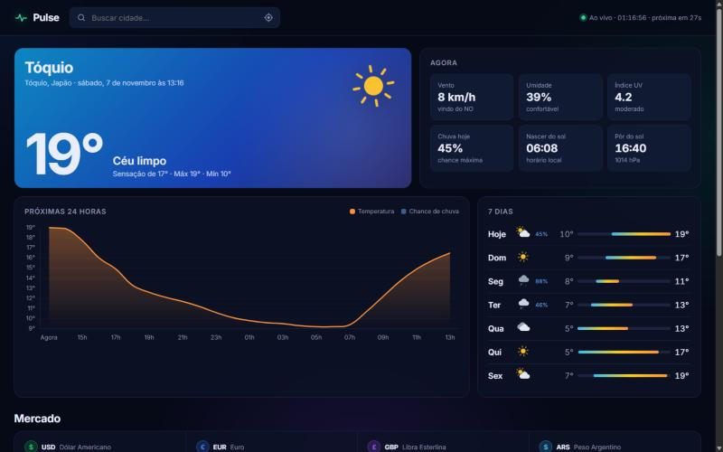
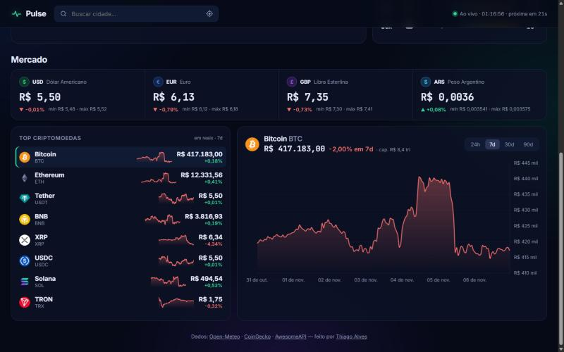

<div align="center">

# 📡 Pulse

**Clima, câmbio e cripto ao vivo num dashboard só.**
Previsão do tempo de qualquer cidade do mundo, cotação do dólar/euro em tempo real e as principais criptomoedas com gráficos — tudo com APIs públicas e gratuitas, **sem nenhuma chave de API**.

[](https://github.com/thiagoalves0707/pulse/actions/workflows/deploy.yml)


### [▶ Abrir o dashboard ao vivo](https://thiagoalves0707.github.io/pulse/)



</div>

---

## ✨ Funcionalidades

### 🌦️ Clima
- **Busca de qualquer cidade** com autocomplete (debounce + navegação por teclado ↑ ↓ Enter) ou **geolocalização**
- **Card principal que muda de cor** conforme o céu e se é dia ou noite na cidade
- **Ícones SVG animados só com CSS** — sol girando, chuva caindo, raio piscando
- **Gráfico das próximas 24h** combinando temperatura (linha) e chance de chuva (barras)
- **Previsão de 7 dias** com barras de mín/máx na escala da semana inteira, pra comparar os dias de relance
- Vento com direção, umidade (com dica "beba água!" no ar seco), índice UV, nascer e pôr do sol
- **Horário local da cidade** calculado pelo fuso que vem da API
- Lembra a última cidade escolhida

### 💹 Mercado



- **Câmbio em tempo real:** dólar, euro, libra e peso argentino em reais, com variação e mín/máx do dia
- **Top 8 criptomoedas** com preço em reais, variação 24h e **mini gráfico de 7 dias** desenhado à mão em canvas
- Clique numa moeda pra ver o **gráfico detalhado** em 24h / 7d / 30d / 90d — verde se subiu, vermelho se caiu
- **Atualização automática a cada 60s** com contador regressivo no topo

---

## 🧠 Decisões técnicas

**Cada card falha sozinho.** Câmbio e cripto vêm de APIs diferentes e são buscados com `Promise.allSettled` — se a CoinGecko cair ou bloquear por excesso de requisições, o clima e o câmbio continuam funcionando e só o card afetado mostra o aviso com botão de "tentar de novo".

**Respeito aos limites das APIs gratuitas.**
- Cache em memória com tempo de vida por endpoint ([`http.ts`](src/api/http.ts))
- Clima atualiza a cada 10 min (a previsão não muda mais rápido que isso); mercado a cada 60s
- **Aba em segundo plano não faz requisição** — e ao voltar, atualiza na hora se os dados estiverem velhos

**Sem condição de corrida.** Se você clicar rápido em várias moedas, cada pedido de gráfico ganha um número; resposta que chega atrasada é descartada ([`market.ts`](src/widgets/market.ts)).

**Leve.** Chart.js com *tree-shaking* (registrando só line/bar), sparklines em canvas puro e formatação de moeda/data com a API `Intl` nativa — nada de moment.js ou numeral.js.

**Acessível.** Lista de moedas navegável por teclado, `aria-label`s, e as animações desligam com `prefers-reduced-motion`.

---

## 🔌 APIs usadas

| Dado | API | Chave? |
|---|---|---|
| Previsão do tempo + busca de cidades | [Open-Meteo](https://open-meteo.com/) | Não |
| Criptomoedas | [CoinGecko](https://www.coingecko.com/en/api) | Não |
| Câmbio | [AwesomeAPI](https://docs.awesomeapi.com.br/) | Não |

## 🚀 Rodando localmente

```bash
git clone https://github.com/thiagoalves0707/pulse.git
cd pulse
npm install
npm run dev
```

## 📁 Estrutura

```
src/
├── api/          # uma função por endpoint, com tipos e conversão dos dados crus
│   ├── http.ts       # fetch com timeout, cache e mensagens de erro amigáveis
│   ├── weather.ts    # Open-Meteo + tradução dos códigos WMO
│   └── market.ts     # CoinGecko + AwesomeAPI
├── ui/           # peças visuais reutilizáveis
│   ├── charts.ts     # configuração/tema do Chart.js
│   ├── icons.ts      # ícones de clima animados em SVG
│   ├── sparkline.ts  # mini gráficos em canvas
│   ├── format.ts     # moeda, %, datas (Intl)
│   └── status.ts     # estados de carregando/erro dos cards
├── widgets/      # cada card do dashboard
└── main.ts       # orquestra tudo e agenda as atualizações
```

---

<div align="center">

Feito por **[Thiago Alves](https://github.com/thiagoalves0707)** · Se curtiu, deixa uma ⭐

</div>
